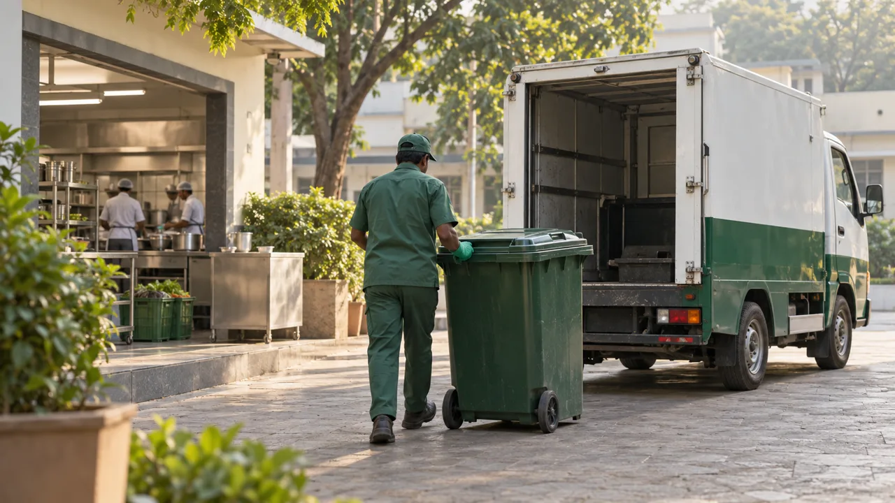

# FeedSure CBG

**Turning bulk food waste into clean energy — with every pickup measured, coordinated and accounted for.**

> **Environmental Hacks 2026 · Bharat Builds Tour** — **Track 3: Waste & Energy.**
> A student project that helps Compressed Bio-Gas (CBG) plants reliably collect
> the organic waste they run on, so more food waste becomes fuel instead of landfill methane.

Before the truck leaves, know which waste suppliers are ready. After it returns, know how much waste the plant actually received.

---

## The problem we picked

India's hotels, hostels, PGs, canteens and institutional kitchens throw out **enormous amounts of wet food waste every day**. Most of it ends up in landfills, where it rots and releases **methane — a greenhouse gas roughly 80× more warming than CO₂ over 20 years** — along with leachate and public-health problems.

That same waste is also a **resource**: it is the feedstock for Compressed Bio-Gas (CBG) plants, which turn organic waste into clean vehicle-grade fuel (India's SATAT programme is building hundreds of them). But these plants share one unglamorous, decisive problem:

> **Feedstock collection is unreliable.** Plants don't know how much waste is actually ready before a truck rolls out. Routes exceed the vehicle's capacity or the day's hours. What a driver picks up at the kerb rarely matches what the plant weighs at the gate. So trucks run half-empty, suppliers are missed, and the plant can't trust its own intake numbers.

When the hand-off between kitchen, truck and plant is messy, waste that *could* become energy goes to landfill instead. **FeedSure fixes the hand-off.**

## What FeedSure does

FeedSure is a single-truck collection system that connects a CBG plant with its bulk food-waste suppliers and makes the whole collection accountable, end to end:

1. **Ready** — a supplier (hotel / hostel / PG / canteen) confirms an estimated quantity and a pickup window.
2. **Plan** — a dispatcher reviews who's ready, resolves capacity conflicts, and freezes a feasible route.
3. **Collect** — the driver follows the route and records full, partial or skipped pickups per stop.
4. **Reconcile** — the plant records net gate intake and compares it with what the driver reported.

The result is a **traceable record for every collection** — confirmed quantity → collected quantity → net received weight — that suppliers, dispatchers, drivers and the plant all share.

## Why it matters (impact)

FeedSure is aimed squarely at the judging question *"what changes for the people living with the problem?"*:

- **Less landfill methane, more clean fuel.** Reliable collection means more organic waste is diverted to CBG plants instead of rotting in a landfill — turning an emissions source into renewable energy.
- **Fewer wasted trips.** Capacity- and window-aware routing means fuller trucks and fewer missed or repeated stops, so the collection operation itself burns less diesel.
- **Trust between parties.** A shared, revisioned record of confirmed vs. collected vs. received weight gives plants dependable feedstock data and gives suppliers proof their waste was handled — the accountability that makes a circular system actually run.
- **Built for non-technical users.** Kitchen staff confirm readiness in a few taps; drivers record outcomes while parked; plant operators enter one net weight. No training, no dashboards to learn.

> We make **no claim of measured emissions savings or field results** — this is a working prototype on synthetic demo data. What we *can* show is a complete, honest collection workflow that removes the coordination gap standing between food waste and clean energy.

## Watch the collection journey

[](frontend/public/media/collection-workflow.mp4)

**[▶ Watch the film — 18 seconds](frontend/public/media/collection-workflow.mp4)**

The landing page opens with a **live, code-generated 3D collection ecosystem** — a miniature world where the truck drives its real route from kitchen to CBG plant — followed by a short film in a "One collection. A clear record at every step." section: **Ready → Collected → Reconcile**.

Silent, with on-screen explanations; [English captions](frontend/public/media/collection-workflow.en.vtt) and a full transcript are provided. Scenes are AI-generated illustrations, not pilot footage. *(The hackathon's required 3-minute demo video is scripted separately — see [DEMO-SCRIPT.md](docs/DEMO-SCRIPT.md).)*

## Built on AWS

FeedSure follows the hackathon's **"Build It" path** — real AWS infrastructure defined as code and runnable locally against an AWS-compatible emulator, with a clear route to deployment:

- **AWS SAM** (`backend/template.yaml`) is the source of truth for the serverless stack.
- Targets **AWS Lambda** (domain handlers), **API Gateway** (HTTP API), **DynamoDB** (collection records), **private S3** (photo evidence), **Amazon Bedrock** (optional photo assistance) and **Amazon Location Service** (routing/map). **Amplify** hosting config is included.
- Runs end-to-end locally through **Moto** (in-process AWS emulation, LocalStack-style) with the *real* Lambda domain handlers — so the full workflow is demonstrable without cloud credentials.

> Honest boundary: live AWS deployment and live Bedrock/Location calls were **not** performed in this build. Local Moto and routing fallbacks demonstrate the logic, not a deployed endpoint. We keep local-emulation evidence strictly separate from any deployed-AWS claim.

## What works locally

Readiness saves without photos or AI. Planning checks full-load capacity reservations, pickup windows and depot return. Dispatch rejects changed inputs; later edits raise alerts while preserving driver stops. Scoped access, retry protection, revisioned corrections, partial pickups and gate reconciliation run through **real domain handlers** on local Moto storage.

Separate interfaces share the same records: suppliers enter through `/supplier-access` and use `/g/:id`, admins/dispatchers use `/admin`, CBG plant owners use `/owner`, drivers use `/driver/:planKey`. The owner desk lists dispatched trips, recorded pickups and net-intake discrepancies with revisioned gate corrections; its distinct `PLANT_OWNER_TOKEN` grants intake access only.

Optional supplier photos start from a live browser camera with a visible supplier/device-time tag and (with permission) GPS. Optional **Supabase** email/password login can open each operator's dashboard. All demo suppliers, quantities and scenarios are **synthetic**; the seed uses OpenStreetMap venue names around Harohalli as demo references only ([attribution](data/README.md)).

## Run and verify

Supabase registration and account management: open `/register` to request generator or CBG
team access, `/login` to sign in, and `/accounts` as an Admin to approve, edit, reset, suspend or
delete accounts. Run all Supabase migrations in order and bootstrap an Admin before enabling
`SUPABASE_ACCOUNT_MANAGEMENT=true`. See [ACCOUNTS.md](docs/ACCOUNTS.md) for environment setup,
testing, lifecycle behavior and the single pilot plant boundary. Public signup needs verification
email delivery; for tests without SMTP, an Admin can create and approve accounts in `/accounts`.

Python 3.12+ and Node/npm are required. Install declared dependencies in a fresh checkout:

```powershell
python -m pip install -e ".[dev]"
python -m pytest -q
Set-Location frontend
npm ci
npm run test
npm run build
```

Then start the disposable local demo (loopback-only, synthetic data, discarded on stop):

```powershell
python scripts/local_demo.py --date 2026-10-12 --port 8787 --frontend-port 5173
```

See [DEPLOYMENT.md](docs/DEPLOYMENT.md) for the full local run. Never publish tokens or `.tmp/` files.

**Latest QA (11 Oct 2026):** 325 backend tests, 101 frontend tests, 10 account SQL checks and the production build pass. Route evaluation covers 18 fixed scenarios. We claim no field savings or screening accuracy — only that the workflow executes correctly on synthetic data.

## Honest boundaries (what we do *not* claim)

Working honestly is part of this project. Photos help with visible items only — never whole-load safety, chemistry, mass or gas yield; hazards need human resolution. Gate records show *received* waste, not independently verified downstream processing. A recorded pickup never proves plant intake. No blockchain, carbon credits, certification, or automated environmental-impact math is claimed. Field benefit and real-world usability remain unvalidated.

## Team

Built for Environmental Hacks 2026 (Track 3: Waste & Energy) by:

- **Rajat Nagda** — [@rajatnagda45](https://github.com/rajatnagda45)
- **Ashwini Kumar** - [@ashwini-361](https://github.com/ashwini-361)
- **Rajarshi Dutta** - [@rajarshidattapy](https://github.com/rajarshidattapy)

## Documentation

- [API](docs/API.md), [database](docs/DATABASE.md), [security](docs/SECURITY.md)
- [Planner policy](docs/PLANNER-V3.md), [synthetic route evaluation](eval/route-results.md)
- [Tests & evidence](docs/TESTING.md), [local run / deployment](docs/DEPLOYMENT.md)
- [Demo script](docs/DEMO-SCRIPT.md), [submission checklist](docs/SUBMISSION.md), [media provenance](docs/FRONTEND-MEDIA.md)
