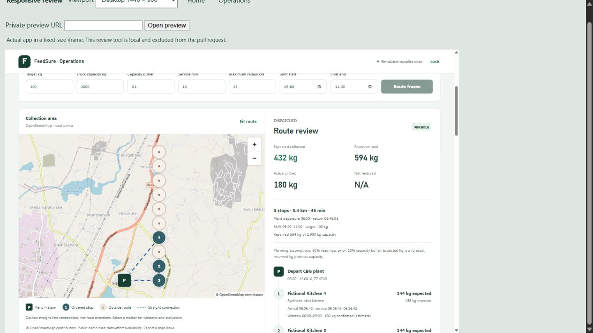

# Frontend design system

The collection desk uses a calm green-and-white interface with a prominent map, readable route
sequence and clear distinctions between expected, reserved, picked and received quantities.
The kitchen form prioritises a quick readiness decision; the driver page prioritises the stop
sequence and the saved state of each outcome. The public page introduces the same collection loop.

## Visual system

| Token | Value | Role |
|---|---|---|
| Ink | `#213e34` | Headings and body text |
| Deep green | `#173f32` | Primary action, identity and driver summary |
| Green | `#237454` | Positive state and interactive emphasis |
| Muted | `#5b6e65` | Supporting labels |
| Wash | `#f1f5f3` | Workspace background |
| Surface | `#ffffff` | Forms and working regions |

Amber and red retain their warning/error meanings. Outside-route map markers use muted stone
colours so they do not compete with the numbered route or imply every exclusion is a hazard.
All map provider, attribution, synthetic-data and provisional-measurement labels remain visible.

Segoe UI Variable/Segoe UI supplies body text; Bahnschrift/Aptos Display supplies headings and
numbers, with system fallbacks. No external font request or new package is required. The two small
SVG assets illustrate the collection loop and route empty state; they do not represent real roads.

`frontend/src/design.css` is deliberately imported after the existing styles. It changes presentation
without rewriting workflow components or their state, keeping the concurrent map/photo changes
independent. Existing selectors for those features receive matching spacing and typography.

## Layout and interaction

- At 1100 px and above the dispatcher map and route review share one workspace. At 1280 px the
  planner controls fit one row. Smaller views stack the map, review and forms in document order.
- Route stops use a connected timeline. Quantity groups have consistent labels and tabular numerals.
- Kitchen quantity entry is larger than secondary inputs; readiness choices use a segmented control.
- Mobile controls keep visible labels and at least 44 px primary targets. Inputs use 16 px mobile
  text. Panels and form tracks shrink without forcing horizontal page overflow.
- Focus outlines, input focus rings and restrained pressed states indicate the active control.
  Save notices enter briefly; loading indicators rotate. Reduced-motion preferences disable both.
- Comparison tables retain their own horizontal scrolling rather than widening the entire page.

## Verification — 11 October 2026

Final verification includes the completed map/photo/access integration at `ded58ed`:

- `npm run test`: **58 passed**, three opt-in API tests skipped in the normal run.
- `npm run build`: **passed**; the existing MapLibre bundle-size advisory remains.
- Full backend `pytest -q -p no:cacheprovider`: **275 passed**, one existing Starlette/httpx warning.
- `git diff --check`: passed.
- Browser review used the actual React app and a separate loopback backend with synthetic kitchens,
  Moto storage, fallback route matrix and the existing labelled public demo basemap.
- A real 1440 px iframe viewport verified the desktop layout; 390 px and 320 px viewports checked
  phone layouts. Document-width checks found no page overflow after fixing the inherited minimum
  body width. The temporary responsive review HTML is ignored and not shipped in the PR.
- Browser actions: authenticated access, a 400 kg target producing a real three-stop draft,
  dispatch, private driver-link retrieval, a saved 180 kg pickup with UNKNOWN GPS, and kitchen
  readiness save. Saved driver data remained present on navigation back to the trip.
- Keyboard Tab moved from quantity entry to the Scale choice with a visible solid focus outline.
- The branded kitchen-access screen accepted the private link and opened the authenticated kitchen.
- Landing, access, dispatcher, kitchen and driver screens were visually inspected. No physical
  device/camera or deployed AWS validation is claimed by this presentation change.

The live user demo and its access manifest were preserved. Browser mutations used a separate
backend and separate private manifest. No tokens, private links, photos or harness files belong
in this change.

The first visual pass was incorporated into `main` by the parallel repository session while this
work was in progress. The follow-up PR preserves it and contains the final 320 px overflow fix,
44 px brand/lock targets, 1100 px split-workspace breakpoint, compact narrow planner controls,
consistent access branding, and this design reference.

The screenshot shows the actual desktop layout in the local responsive review iframe. Its map
uses the labelled public demo basemap; route distances still come from the fallback matrix.
