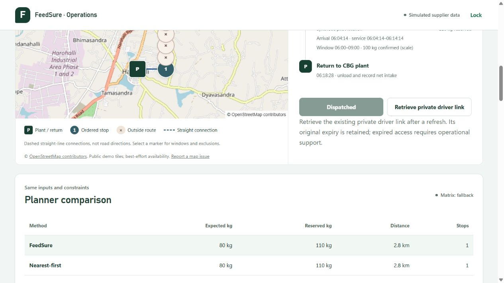
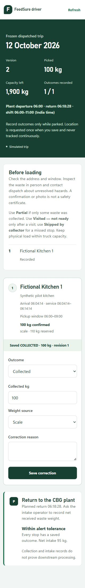
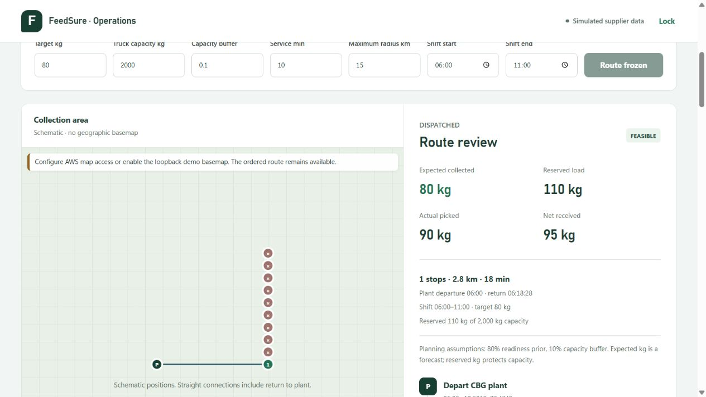

# Product integration verification — 11 October 2026

Verified local prototype: real HTTP/domain handlers, Moto DynamoDB, private filesystem photo bytes, synthetic kitchens, configured mock observations and fallback route estimates. OpenStreetMap is the local basemap provider. No live AWS, physical camera, GPS accuracy or field impact claim follows from these checks.

## Product improvements

Role entry identifies kitchens, dispatchers and drivers, explains their private access and accepts only links for the selected role on the current site. Unknown routes and invalid credentials explain the next step. Dispatcher evidence retrieval uses authenticated API headers; human hazard resolution still requires a reason.

Kitchen details and collection records load independently. Failed reads show explicit retry states. Refreshing collection records preserves an unsaved readiness edit and photo preview. Readiness fields and language controls lock while saving; the saved confirmation identifies weight source and server save time in India time. Records distinguish loading, unavailable and empty states.

## Actual verification

| Check | Result |
| --- | --- |
| Full backend suite on isolated PR snapshot | 275 passed in 33.36 s; one existing Starlette/httpx deprecation warning |
| Frontend suite | 58 passed, 3 opt-in tests skipped |
| Opt-in `local-workflow.test.ts` with a separate manifest | All 3 passed in 4.71 s |
| `verify_repair_integration.py`, clean fixture | PASS on both initial and stable isolated APIs |
| Same script, malformed fixture and `--expect-failed-analysis` | PASS; readiness survived failed analysis |
| Production build | Passed; existing MapLibre bundle-size advisory |
| Independent photo HTTP smoke | 13 checks passed, including exact PNG/JPEG retrieval |

Restricted Windows runs stalled in asyncio `_fallback_socketpair` before requests reached the app and were interrupted. They are not passing results. The approved environment completed the suites.

HTTP checks saved readiness without photos, rejected invalid bytes and cross-kitchen access, replayed upload safely, rejected stale dispatch, froze the saved route, recorded 100 kg pickup and 95 kg gate intake, and read the kitchen's own record. Client tests also covered partial outcomes, correction revisions, retry conflicts and recalculated reconciliation.

## Actual browser evidence

The in-app browser exercised private role entry and rejected a link for another site. It retrieved saved kitchen readiness, actual uploaded bytes and collection records after refresh. Dispatcher photo review rendered authenticated evidence and labelled mock observations as unrelated to the image. The copied private driver link opened only its assigned trip and was removed from the address bar. Saved outcomes and return-to-plant instructions were visible.

A driver correction changed pickup from 100 kg to 90 kg, persisted revision 2 after refresh, and recalculated the 95 kg gate comparison to +5 kg. The kitchen's own record showed 90 kg. Refresh records retained an unsaved 222 kg kitchen edit; saving then persisted that value and its scale source. The dispatcher showed the changed-input alert and retained the frozen 100 kg stop.

The independent photo owner verified PNG select/preview/upload/analysis/reload, JPEG preview cancellation and replacement, invalid `.jpg` rejection, removal/reload and preserved 125 kg readiness. The browser-produced JPEG was 3,260 bytes; SHA-256 `c245eb3fc8a55140766a4d933c7d844020c720c7774bbbbf1ead2021e0602f70` matched authenticated retrieval and the private stored file. That fixture is synthetic image data, not a food photograph or model-accuracy evidence.

Desktop screenshots show real OSM tiles, attribution, the numbered saved stop and depot return, an explicit straight-line label and a separately usable ordered list. Dispatcher, kitchen and driver layouts were inspected at 390 px and 320 px without horizontal page overflow. Screenshot images contain only disposable synthetic data.

Restarting only the isolated frontend with `VITE_LOCAL_DEMO_BASEMAP=off` showed the labelled schematic fallback while retaining the saved route, frozen quantities and recalculated execution data. This is missing-configuration fallback evidence, not a forced tile/WebGL-failure test.

## Remaining verification

Live S3, Bedrock and Amazon Location operation, SAM build/deployment, physical phone-camera and GPS behavior remain unverified. Tile/WebGL failure recovery and camera retention have automated lifecycle coverage; forced tile/WebGL failure was not exercised in this browser. Desktop file selection does not prove a physical camera works. No video, licence choice or hackathon submission was made here.

The initial role-entry/photo-viewer improvements were pushed to main by a concurrent repository chat during this task. This follow-up PR preserves them and adds the final kitchen safeguards, verification evidence and corrected run instructions. Unfinished plant-owner/login changes and the separate design-polish PR are excluded.
