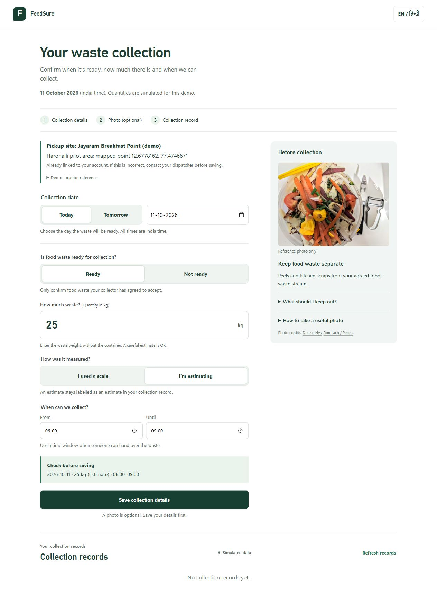
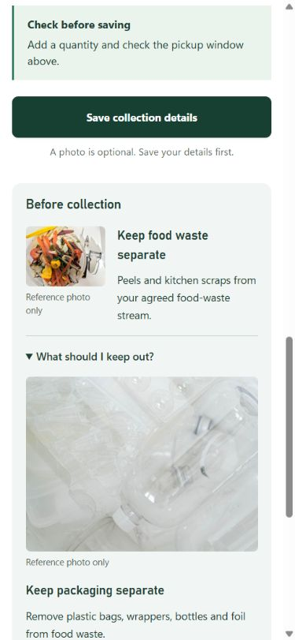

# Organic waste collection: minimum daily details

The supplier's private link identifies their site and saved pickup address. Show these for
confirmation rather than asking them to type their identity, phone or address every day.

| Input | Required when | Purpose |
|---|---|---|
| Collection date | Always | A confirmation applies to one day in India time |
| Ready / not ready | Always | Tells the dispatcher whether waste will be available |
| Waste weight in kg | Ready | Quantity excluding the container; positive and at most 5,000 kg |
| Scale / estimate | Ready | Preserves how the quantity was obtained |
| Pickup start and end | Ready | Same-day window when someone can hand over the waste |
| Short reason | Optional, not ready | Explains closure or no waste |
| One actual waste photo | Optional, after saving ready details | Visible-item assistance; never a weight or safety measurement |

No additional API fields or database changes. The enrolled site already defines the accepted
food-waste stream. Do not add a required category selector for material that this pilot cannot
accept, uncalibrated bin-to-kg conversions, chemistry questions, or repeated contact fields.

## User and data flow

1. Open the private link; check the linked site/address and choose today, tomorrow or another date.
2. Confirm readiness. Ready reveals kg, weight source and the site's editable time window;
   not ready only offers an optional reason. Read the live summary and save.
3. The existing readiness endpoint persists the confirmation and returns the authoritative record.
   Show the saved status, weight source and next action. Saving is not a pickup booking.
4. Only a saved READY confirmation exposes camera/upload. Preview the actual waste, upload,
   then optionally check visible items. Photo failure cannot undo the saved confirmation.
5. Dispatcher plans and dispatches; driver records the pickup; plant records trip-level net intake.
   The supplier's existing collection records show their own pickup and the linked trip's gate status.
   Edits after dispatch alert the dispatcher, without changing the frozen route.

The preparation guide and camera guidance are available in English and Hindi. Reference photos
are labelled examples, never uploaded as evidence and never used to prefill a quantity. Guidance
stays readable if images fail. No new browser permissions are requested by the form.

## Image credits

Bundled resized JPEGs keep the private-link page from requesting third-party stock-photo servers.
Both are used under the [Pexels license](https://www.pexels.com/license/), checked 11 October 2026.

- `frontend/public/images/food-scraps.jpg`: [Denise Nys, Pile of Organic Waste](https://www.pexels.com/photo/pile-of-organic-waste-14824327/).
- `frontend/public/images/keep-plastics-separate.jpg`: [Ron Lach, Photograph of Plastic Bottles on a White Surface](https://www.pexels.com/photo/photograph-of-plastic-bottles-on-a-white-surface-8286620/).

These illustrate separation, not an exhaustive plant acceptance policy. Acceptance follows the
collector's agreement with the enrolled site. Hazards require human resolution.

## Verification

- Frontend: 86 tests pass; three existing opt-in integration tests are skipped. Production build passes.
- Backend: 286 tests pass against local mocks.
- Browser with the disposable local API: required-weight error and focus, reversed window error,
  measured READY save without photo, NOT_READY save with reason and persistence after reload,
  date switching, Hindi controls, expandable guidance and both loaded images.
- Responsive checks at 390px and 320px: no horizontal overflow. Physical camera capture and live
  cloud storage were not exercised in this UI change; their existing code paths are retained.
- Existing large-JavaScript-bundle warning remains in the build.

